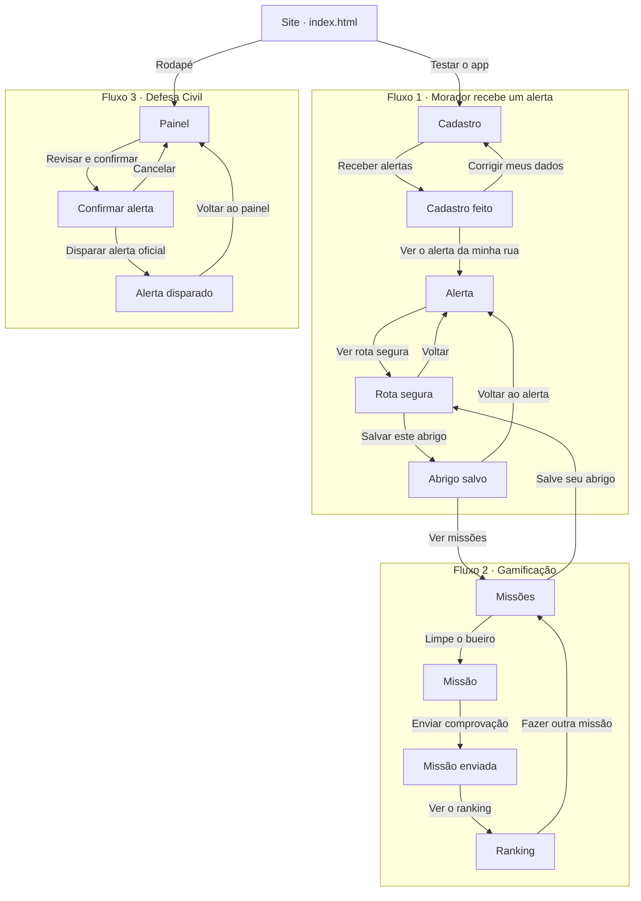

# ALERA · Sprint 2: fluxos e arquitetura

Os 3 fluxos são os que o Design System v0.1 (Sprint 1, página 5) definiu. Na Sprint 2 eles viraram telas navegáveis em HTML e CSS, usando os tokens e componentes da Sprint 1.

| # | Fluxo | Perfil | Telas (pasta `app/`) |
| --- | --- | --- | --- |
| 1 | **Morador recebe um alerta** (principal) | Morador de área de risco | `cadastro` → `cadastro-concluido` → `index` (alerta) → `rota` → `abrigo-salvo` |
| 2 | Gamificação (fora da crise) | Morador de área de risco | `missoes` → `missao-bueiro` → `missao-enviada` → `ranking` |
| 3 | Defesa Civil | Gestor da Defesa Civil | `painel` → `painel-confirmar` → `painel-enviado` |

---

## Fluxo 1 (principal): morador recebe um alerta

**Perfil.** Morador de área de risco de Juiz de Fora. Usa celular simples, com internet instável, com uma mão e muitas vezes com pressa e debaixo de chuva (Sprint 1, "Usuários").

**Tarefa.** Cadastrar o telefone e a rua, ver o alerta da própria rua, abrir a rota segura e salvar o abrigo para onde vai.

**Caminho principal.**

1. No site, toca em **Testar o app** e chega ao **Cadastro**.
2. Preenche telefone (WhatsApp), rua e bairro e toca em **Receber alertas no WhatsApp**.
3. **Cadastro feito:** vê a confirmação e um exemplo do alerta que vai chegar no WhatsApp. Toca em **Ver o alerta da minha rua**.
4. **Alerta:** vê o nível (ALERTA), a rua, a hora, o que fazer e o abrigo mais perto. Toca em **Ver rota segura**.
5. **Rota segura:** vê o mapa simplificado, a rua a evitar e os passos. Escolhe o abrigo e toca em **Salvar este abrigo**.
6. **Abrigo salvo:** a missão "Salve seu abrigo" é concluída (+30 pts).

**Caminhos alternativos.**

- **Corrigir dados:** em "Cadastro feito", o botão **Corrigir meus dados** volta ao cadastro. A aba **Meus dados** leva ao mesmo lugar.
- **Outro abrigo:** na rota, pode escolher o Ginásio Poliesportivo em vez da escola.
- **Abrir no Google Maps** ou **Ligar 199** direto da rota.
- **Entender a escala:** o bloco "O que fazer em cada nível" explica os 4 níveis antes da crise.

**Pontos de falha e o que a tela faz.**

| Falha | O que a pessoa vê |
| --- | --- |
| Telefone sem DDD | Borda vermelha + "Digite o telefone com DDD." |
| Rua com uma palavra só | Borda vermelha + "Digite o nome completo da rua." |
| Bairro não escolhido | Borda vermelha + "Escolha o seu bairro." |
| Tentar enviar com erro | O envio é bloqueado e o botão fica vermelho até corrigir |
| Salvar sem escolher abrigo | Os cards ficam com borda vermelha + "Escolha um abrigo para salvar." |
| Abrigo fechado | O card aparece apagado e não pode ser escolhido |
| Sem internet (alerta sem dados) | O card de alerta fica cinza: "Sem internet: não sabemos o nível agora. Em caso de risco, ligue 199." (estado disabled, na vitrine) |
| Alerta não atualizou | Card com borda vermelha: "Não deu para atualizar" (estado error, na vitrine) |

---

## Fluxo 2: gamificação (fora da crise)

**Perfil.** O mesmo morador, num dia sem chuva forte. Precisa de um motivo para cuidar da rua.

**Tarefa.** Fazer a missão "Limpe o bueiro", comprovar com foto e ver a rua subir no ranking.

**Caminho principal.**

1. Aba **Missões**: vê as missões com pontos e progresso coletivo. Toca em **Limpe o bueiro da sua rua**.
2. **Missão:** lê os 4 passos de como fazer (ação real na rua).
3. **Comprova:** escolhe o que fez, envia a foto do bueiro limpo e toca em **Enviar comprovação**.
4. **Missão enviada:** +50 pts para a Rua Exemplo; a barra mostra 4 de 5 vizinhos.
5. **Ranking:** a Rua Exemplo aparece com 1.030 pts, em 2º lugar.

**Caminhos alternativos.** A missão "Salve seu abrigo" leva para a rota (fluxo 1). Voltar às missões a qualquer momento pelo topo ou pela aba. Comentário na comprovação é opcional.

**Pontos de falha.**

| Falha | O que a pessoa vê |
| --- | --- |
| Não escolheu o que fez | "Escolha o que você fez." |
| Sem foto | "Envie uma foto do bueiro." e o envio fica bloqueado |
| Missão ainda não aberta | O card "Plante uma muda" aparece apagado, sem link: "abre no próximo mutirão da encosta" |

---

## Fluxo 3: Defesa Civil

**Perfil.** Gestor da Defesa Civil, no computador, acompanhando várias áreas ao mesmo tempo (Sprint 1, "Usuário secundário").

**Tarefa.** Ver que um sensor mudou o nível de uma área, confirmar o alerta oficial e disparar para os moradores.

**Caminho principal.**

1. **Painel:** vê o aviso do Sensor ALERA ("PERIGO sugerido" na Encosta do Centro) e a tabela com o nível de cada área.
2. Toca em **Revisar e confirmar o alerta**.
3. **Confirmar:** confere a área, o nível e a mensagem (até 160 caracteres, cabe no WhatsApp), marca a confirmação e toca em **Disparar alerta oficial**.
4. **Alerta disparado:** vê quantos moradores receberam e a mensagem enviada.

**Caminhos alternativos.** **Cancelar** volta ao painel sem disparar. Pode trocar a área e o nível antes de disparar.

**Pontos de falha.**

| Falha | O que o gestor vê |
| --- | --- |
| Área ou nível não escolhido | "Escolha a área do alerta." / "Escolha o nível do alerta." |
| Mensagem vazia | "Escreva o que o morador deve fazer." |
| Não marcou a confirmação | O texto da confirmação fica vermelho e o disparo é bloqueado |

Regra da Sprint 1 mantida: no PERIGO, a mensagem diz só o essencial, sair de casa e para onde ir.

---

## Componentes por página

Nomes do design system (`css/tokens.css` e `css/app.css`).

| Página | Componentes |
| --- | --- |
| **Site** (`index.html`) | Cabeçalho com menu, botão principal "Testar o app", números do problema, passos de "Como funciona", selos de nível, cards de missão, rodapé |
| **Cadastro** (`app/cadastro.html`) | Topo (marca + tema), formulário de cadastro, campo de texto (telefone, rua), seleção (bairro), botão, navegação inferior |
| **Cadastro feito** | Ícone de confirmação, card de alerta compacto (exemplo), botão, botão secundário |
| **Alerta** (`app/index.html`) | Card de alerta (composto), legenda dos níveis, cards "O que fazer em cada nível", navegação inferior |
| **Rota segura** | Topo de tarefa (Voltar), mapa simplificado com botão de tema do mapa, card do destino, aviso da rua a evitar, passos numerados, cards de abrigo (seleção), botão, botão secundário |
| **Abrigo salvo** | Ícone de confirmação, pontos ganhos, botão, botão secundário |
| **Missões** | Cards de missão (link) com selo de pontos e barra de progresso, card de missão bloqueada |
| **Limpe o bueiro** | Topo de tarefa, selo de pontos, passos numerados, seleção, campo de foto, área de texto, botão |
| **Missão enviada** | Ícone de confirmação, pontos ganhos, barra de progresso, botões |
| **Ranking** | Lista do ranking com avatar e destaque da "sua rua", botão |
| **Painel** | Topo do painel, card de alerta (aviso do sensor), tabela de áreas com selos de nível |
| **Confirmar alerta** | Topo de tarefa, seleção (área, nível), área de texto, caixa de marcar, botão, botão secundário |
| **Alerta disparado** | Ícone de confirmação, card de alerta compacto, botão |
| **Componentes** (`app/componentes.html`) | Vitrine dos 5 componentes do fluxo principal nos 6 estados |

## Componentes do fluxo principal e seus estados

| Componente | Hover | Focus | Active | Disabled | Error |
| --- | --- | --- | --- | --- | --- |
| Botão `.botao` | Azul mais escuro | Anel azul com borda branca | Escurece e afunda | Cinza, sem clique | Vermelho quando o formulário tem erro |
| Campo de texto `.campo__entrada` | Borda escura | Borda azul + anel | Fundo azul claro | Borda tracejada, fundo apagado | Borda vermelha + mensagem embaixo |
| Seleção `.selecao` | Borda escura | Borda azul + anel | Fundo azul claro | Borda tracejada | Borda vermelha + mensagem |
| Card de abrigo `.abrigo` | Borda escura | Anel azul no card inteiro | Escolhido: azul claro com borda azul | Abrigo fechado: tracejado, sem clique | Borda vermelha + "Escolha um abrigo" |
| Card de alerta `.alerta` (composto) | Sombra maior | Anel azul quando o botão de dentro tem foco | Afunda um pouco | Sem dados: faixa cinza | Não atualizou: borda vermelha |

O foco nunca some sem substituto: todo `outline` removido ganha um anel de foco (`--app-foco`) no lugar.

## Fluxograma de navegação

A navegação inferior do app (Alerta, Missões, Ranking, Meus dados) aparece em todas as telas do morador, menos nas telas de uma tarefa só (Rota, Missão), que têm o botão **Voltar** no topo: a tela fica só com o essencial (princípio da Sprint 1).

## Critérios técnicos

- **HTML semântico:** `header`, `nav` com `aria-label`, `main`, `section`, `article`, `footer`, `form`, `fieldset` + `legend`, `table` com `caption` e `th scope`.
- **Hierarquia de títulos:** um `h1` por página; `h2` e `h3` em ordem.
- **Landmarks:** topo (`header`), conteúdo (`main`), navegação do app (`nav`), rodapé (`footer`); link "Pular para o conteúdo" no primeiro Tab.
- **Celular primeiro:** o CSS parte do celular e abre colunas a partir de 600 px e 900 px. Conferido em 390 px e 1366 px.
- **Teclado:** tudo funciona com Tab, Enter e espaço, com foco sempre visível. A aba da página atual tem `aria-current="page"`.
- **Acessibilidade:** nenhuma violação WCAG 2 A/AA no axe-core nas 13 telas.
